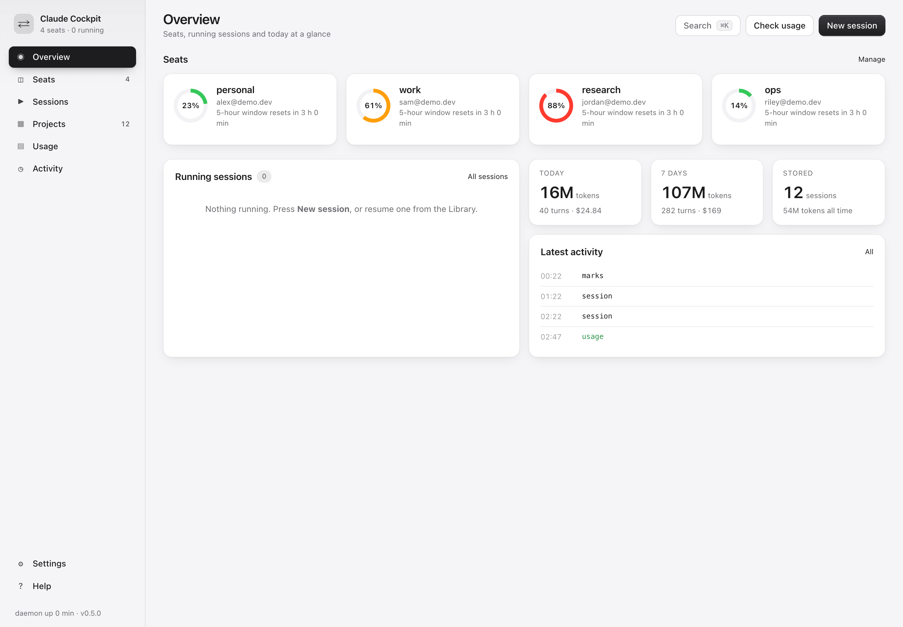
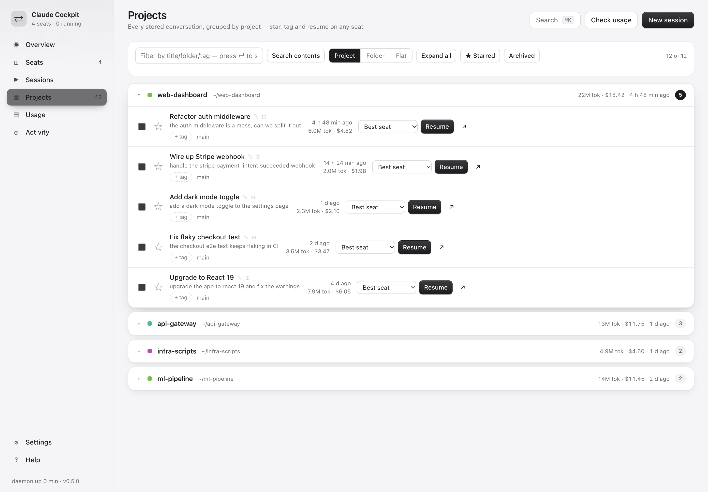
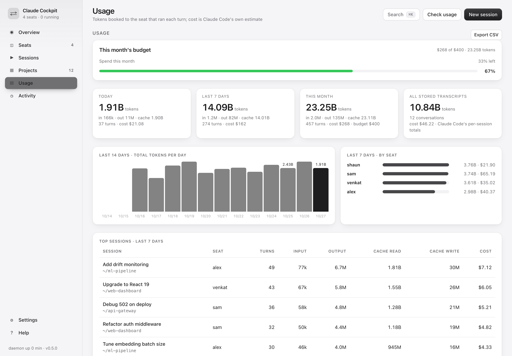
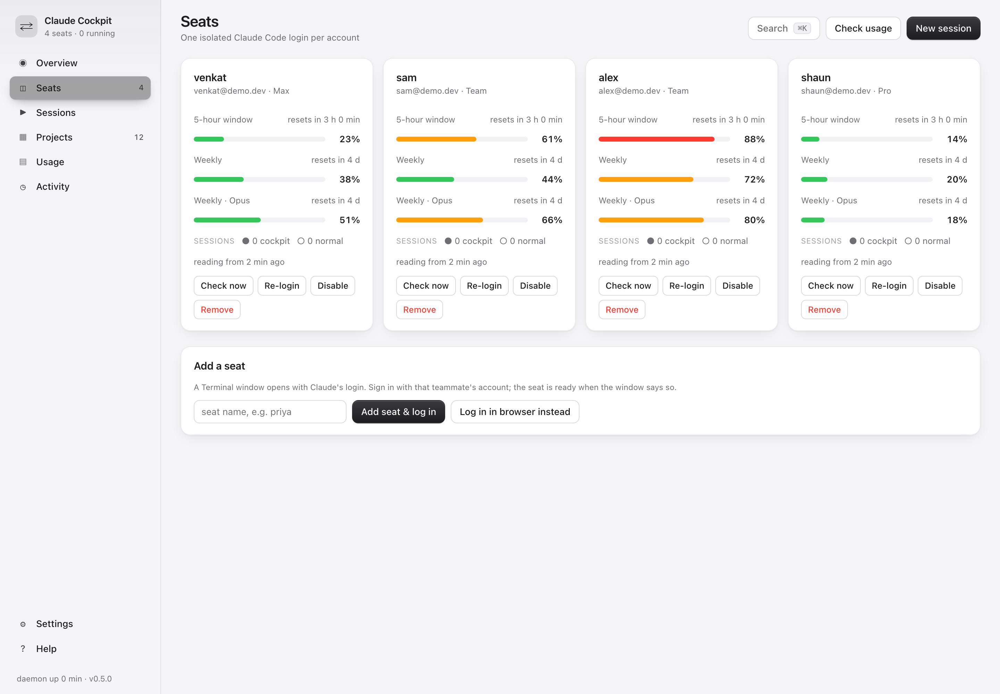
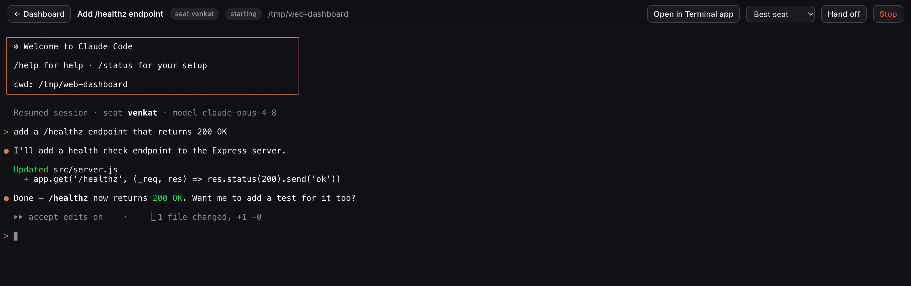
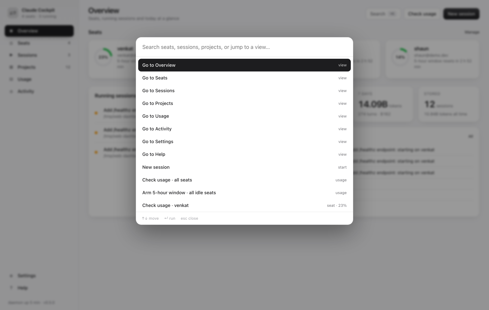
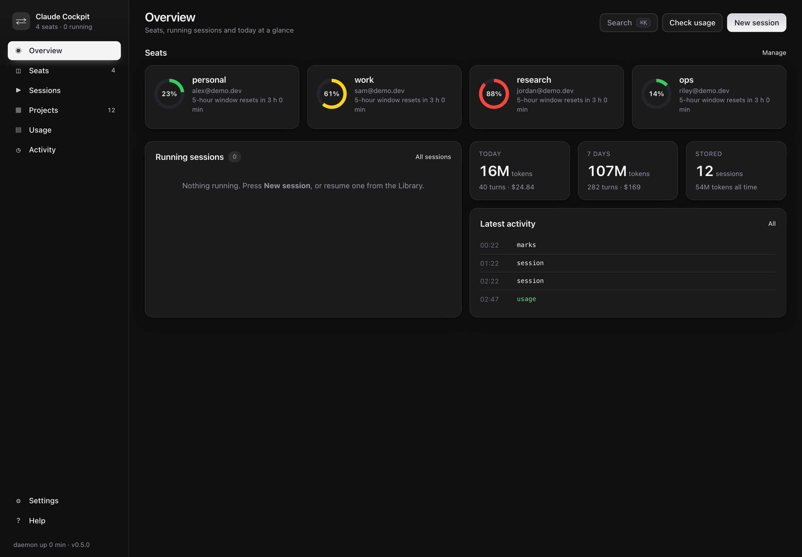

<div align="center">

# Claude Cockpit

### A local control room for Claude Code.

Run sessions in the background, attach to any of them from your browser or Terminal,
search and organize everything you've ever run, and manage several accounts from one dashboard.

[](https://github.com/Venkat-jaswanth/claude-cockpit/releases)
[](LICENSE)


<br>

<picture>
  <source media="(prefers-color-scheme: dark)" srcset="docs/overview-dark.png">
  
</picture>

</div>

## Why

Claude Code is great in a single terminal. The moment you lean on it for real work, the rough edges show up:

- A session dies the instant you close the tab or quit the terminal.
- You lose track of what you ran, and where, across dozens of folders.
- Running a second account means logging out and back in.
- Nothing shows you, at a glance, what's running and how much headroom is left.

**Claude Cockpit** turns Claude Code into something you run from a control room. Every session lives
in a background daemon, so closing a tab never kills your work. You attach to any session from a
browser tab or from Terminal.app, whichever is in front of you. Every conversation you've ever run is
searchable, groupable and resumable. And each account stays logged in as its own seat, with its live
usage always on screen.

It reads **only** the rate-limit numbers Claude Code already caches on disk. It never reads your OAuth
tokens or your Keychain, it makes no network calls of its own, and it never sends a prompt you didn't ask for.

## Features

Not just an account switcher. This is where your sessions live, run, and get found again.

### Run &amp; attach

| | |
|---|---|
| **Background sessions** | Every session runs in a PTY owned by the daemon. Close the tab or quit Terminal and it keeps running. Reattach whenever you come back. |
| **Browser or Terminal** | Open any live session as a full terminal in a browser tab, or pop it into Terminal.app. Same session either way. |
| **Scheduled runs** | Queue a session to start now, in a few hours, or at a seat's next reset, with an initial task waiting for it. |
| **Command palette** | Press `⌘K` to jump to any view, seat, session or action. |

### Organize everything

| | |
|---|---|
| **Session library** | Every stored conversation, grouped by git repo. Star, tag, note, archive and resume any of them on any seat. |
| **Full-text search** | Grep across every transcript on the machine and get readable snippets back. |
| **Bulk actions** | Select a batch of conversations and star, tag, move, archive or delete them in one go. |

### Several accounts, one view

| | |
|---|---|
| **Isolated seats** | One `CLAUDE_CONFIG_DIR` per account, each with its own credentials. Projects, memory, plugins, skills and history are shared through symlinks, so every seat sees the same work. |
| **Usage without tokens** | Reads each account's cached 5-hour and weekly rate-limit status straight from disk. No OAuth tokens, no Keychain, no network calls. |
| **Burn-rate &amp; ETA** | Per-seat burn rate (%/hour) and time-to-full, so you know which seat to reach for next. |
| **Arm the 5-hour window** | Kick off a seat's window at roughly zero cost with a cheap model, one seat or every idle seat at once. |
| **Opt-in handoff** | When a seat runs low, move a running session to a fresher one between turns and carry on. Ships **off by default**. |

### Spend &amp; polish

| | |
|---|---|
| **Token &amp; cost accounting** | Tokens booked per turn to the seat that ran them: today, 7 days, all-time, a 14-day chart, per-seat spend, top sessions, CSV export. |
| **Monthly budget** | Set a monthly spend cap and watch the budget bar fill. |
| **Status line** | Show the active seat's remaining window right in Claude Code's status line. |
| **Light &amp; dark** | A calm graphite theme, both ways. |

## Screenshots

**Projects.** Every conversation grouped into collapsible folders, resumable on any seat.



<table>
<tr>
<td width="50%" valign="top">

**Usage.** Budget, a 14-day trend, per-seat spend and top sessions.



</td>
<td width="50%" valign="top">

**Seats.** One isolated login per account, each with its own windows.



</td>
</tr>
</table>

**Attach in the browser.** Open any live session as a full terminal in a tab, hand it off, or stop it.



<table>
<tr>
<td width="50%" valign="top">

**Command palette** (`⌘K`). Jump anywhere or run any action.



</td>
<td width="50%" valign="top">

**Dark mode** throughout.



</td>
</tr>
</table>

## Install

> npm distribution is planned. For now, install from source.

```bash
git clone https://github.com/Venkat-jaswanth/claude-cockpit ~/claude-cockpit
cd ~/claude-cockpit && npm install && npm link   # puts `cockpit` on your PATH
cockpit init --name <your-seat-name>             # adopts the current ~/.claude login as seat 1, installs hooks, starts the daemon
cockpit daemon install                           # launchd: start at login, restart if it dies
cockpit open                                     # opens the dashboard, where you add other accounts as seats
```

**Requirements:** macOS, Node 20+, Claude Code 2.1+ on the `PATH`, and `curl`.

<details>
<summary><b>Everyday use</b> (the CLI; everything here is also a button in the dashboard)</summary>

<br>

```bash
cockpit start                        # Claude Code in this folder, on the seat with the most headroom
cockpit start --seat sam -n api      # pin a seat, name the session
cockpit start -- --model opus        # anything after -- is passed straight to claude
cockpit resume <id or title>         # resume any stored session, on the best seat
cockpit attach [name]                # re-enter a running session; Ctrl-] detaches
cockpit handoff [name] --to alex     # move a session now, or after its current turn
cockpit status                       # seats, usage, sessions
cockpit usage [seat]                 # refresh the 5-hour reading of idle seats now
cockpit seat add <name>              # log another account in as a seat
cockpit config set handoff.mode ask  # enable handoff (see the note below)
```

Inside Claude Code nothing changes: same keys, same `/commands`, same TUI. A handoff shows
one cyan line, then the same conversation continues.

</details>

## Account sharing: please read

Cockpit is built to manage **accounts you are entitled to use**: your own plans, or
accounts whose owners have each signed in on their own seat.

**Anthropic's consumer terms prohibit sharing an account with anyone else, and Team seats
are per named user.** Running *your* session on *someone else's* seat is account sharing even
when they agree, and it can get accounts suspended. For that reason **automatic handoff ships
off (`handoff.mode: off`)**, so cockpit never moves a session on its own until you turn it on.
Enabling handoff across accounts that aren't yours is a choice you make, with that risk.

<details>
<summary><b>How a handoff works</b></summary>

<br>

1. Claude Code's `Stop` hook tells the daemon the turn is over.
2. The daemon reads every seat's cached usage and applies your policy (`off` / `ask` / `auto`).
3. It sends Ctrl-C, Ctrl-U, `/exit` to the session's terminal and waits for exit.
4. It spawns `claude --resume <id>` under the next seat's `CLAUDE_CONFIG_DIR`.
5. `SessionStart` (source `resume`) confirms the session is back; an interrupted prompt is re-sent.

The session's folder is pre-trusted on every seat it runs on, so a handoff never stops at
Claude Code's "Is this a project you trust?" prompt. Sessions started with a plain `claude`
are still visible on the dashboard (their hooks report in) but can't be attached or handed off.

</details>

<details>
<summary><b>Where state lives</b></summary>

<br>

```
~/.claude-cockpit/config.json      seats and policy
~/.claude-cockpit/state.json       sessions and event log
~/.claude-cockpit/ledger.json      token ledger by day, seat and session
~/.claude-cockpit/marks.json       stars, tags and notes (cockpit never writes into transcripts)
~/.claude-cockpit/profiles/<seat>  one CLAUDE_CONFIG_DIR per seat
~/.claude-cockpit/daemon.log
```

Hooks are added to each seat's `settings.json` under `SessionStart`, `UserPromptSubmit`,
`Stop`, `StopFailure`, `SessionEnd`. Each is a single `curl` to `127.0.0.1`, tagged
`# claude-cockpit`; `cockpit hooks uninstall` removes only those. The daemon listens on
`127.0.0.1` only and rejects browser requests whose `Origin` isn't the dashboard itself.

</details>

## Platform support

Cockpit runs on **macOS** today. The platform-specific surface is small and isolated to
three files: launchd (`src/daemonctl.js`), `osascript` notifications (`src/notify.js`), and
opening Terminal.app (`src/daemon.js`). A Linux port (systemd + `notify-send` +
`x-terminal-emulator`) is a modest job and a Windows port a larger one. Contributions are
welcome, see [`CONTRIBUTING.md`](CONTRIBUTING.md).

<details>
<summary><b>Caveats</b></summary>

<br>

- **Usage freshness.** A seat's limit reading only refreshes while a session runs on it. Idle
  seats show their last known value; once the window's reset time passes, cockpit assumes 0%.
- **Resume dialog.** On some plans Claude Code asks "Resume this conversation?" after a long
  break. Answer it; a re-sent prompt may need to be typed again.
- **Flags on resume.** Flags after `--` are re-applied on every resume; a positional prompt is not.
- **Token counts** come from transcript files whose format is internal to Claude Code and can
  change between versions. Forked sessions copy their history, so the all-time figure can
  count a fork twice.

</details>

## Test

```bash
npm test   # drives the real CLI, daemon, hooks, PTY sessions, WebSocket attach and the HTTP API against a fake Claude binary
```

## License

[MIT](LICENSE) © 2026 Venkat Jaswanth
